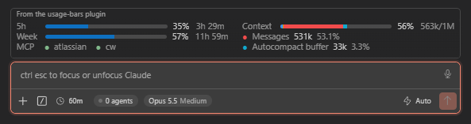

# claude-vscode-usage-bars

A unofficial Claude Code mod that shows your plan limits, context window and MCP server status in a compact panel above the prompt, so you don't have to open `/usage` or `/context` to check them.



## What it shows

The panel is made of sections. You choose which ones appear and where (see [Layout](#layout)).

| Section | What it shows |
|---|---|
| `5h` | Usage of the 5-hour session limit, with the time until it resets. |
| `week` | Usage of the weekly limit, with the time until it resets. |
| `fable` | Usage of the Fable limit. Shows `—` until Claude Code reports it. |
| `context` | How full the context window is, split into the same colored categories as `/context`, with the percentage and `used/max` tokens. |
| `categories` | The context categories (messages, system tools, memory files, …) with their tokens and share of the window, largest first. |
| `mcp` | Each MCP server, with a green dot when it's connected and a red dot with `(disconnected)` when it drops. |

Limit bars turn Claude orange from 80%. Countdowns update every minute. A spend limit, when your plan has one, gets its own row under the panel.

## Layout

The layout is fully customizable with one command:

```
/usage-bars layout <words>…
```

- Each word is one row. `c` (or `|`) starts the next column.
- Repeat a section down a column to give it more rows, for example `categories categories` shows two lines of categories.
- Repeat a section on the same row of neighbouring columns to make it span them.
- Only the sections you list are shown.

Other commands:

| Command | What it does |
|---|---|
| `/usage-bars` | Shows the current layout. |
| `/usage-bars layout reset` | Goes back to the default layout. |
| `/usage-bars help` | Shows the syntax, every section and examples. |

The layout is saved and applies to every open session.

### Examples

**Default.** Limits and MCP on the left, context with two lines of categories on the right.

```
/usage-bars layout 5h week mcp c context categories categories
```


**Context first.** The context bar on its own row across the top.

```
/usage-bars layout context 5h week c context categories mcp
```


**Context with limits on the left.** Context in the left column, categories and MCP on the right.

```
/usage-bars layout context 5h week c categories categories mcp
```


**Limits on top.** Both limits side by side, then the context bar and its categories at full width.

```
/usage-bars layout 5h context categories c week context categories
```


## How it works

- Limits come from the rate-limit data Claude Code already receives with each response. No extra API calls.
- A session only sees the readings from its own requests. All open sessions share their latest reading through the plugin store, so an idle window catches up within 15 seconds when another session spends the plan. A limit missing from a reading keeps its last value until it resets.
- The context categories are estimated locally from the last response. It doesn't send a token-count request on every turn.
- MCP status comes from which servers currently have tools. Servers with no tools are hidden.

The panel draws with native boxes in graphical surfaces (VS Code, Desktop) and falls back to block-character bars in the terminal.

## Install

Requires a Claude Code build with mod support (VS Code extension 2.1.299+, CLI 2.1.287+).

```sh
claude plugin marketplace add VoronFX/claude-vscode-usage-bars
claude plugin install usage-bars@usage-bars
```

Or, from inside a session:

```
/plugin marketplace add VoronFX/claude-vscode-usage-bars
/plugin install usage-bars@usage-bars
```

Then run `/reload-plugins` or start a new session.

### Update

```sh
claude plugin update usage-bars@usage-bars
```

Auto-update is off by default for third-party marketplaces. To turn it on, go to `/plugin` → Marketplaces.

> Mods run unsandboxed with your user permissions. Read [hooks/register.tsx](hooks/register.tsx) before installing. It's a single file.

## Development

```
.claude-plugin/plugin.json       plugin manifest
.claude-plugin/marketplace.json  makes this repo installable as a marketplace
hooks/hooks.json                 registers the mod module
hooks/register.tsx               the mod
types/index.d.ts                 plugin state types
tests/                           render and command tests
previews/                        screenshots, each named after its layout command
```

To try local changes, load the folder directly:

```sh
claude --plugin-dir .
claude plugin validate .
claude plugin test .
```

The first interactive `--plugin-dir` session writes type definitions for your Claude Code version into `.claude-plugin/types/` (gitignored). [tsconfig.json](tsconfig.json) extends it, so editor type-checking works after that first run.

## Disclaimer

This plugin, including its code and this README, was generated by Claude (Anthropic's AI assistant). It is provided as is, without warranty of any kind. I take no responsibility for how it behaves or for any consequences of using it. Review the code and use it at your own risk.

This is an unofficial community project. It is not affiliated with or endorsed by Anthropic.

## License

[MIT](LICENSE)
