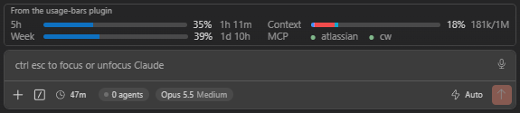

# claude-vscode-usage-bars

A Claude Code mod that shows your plan limits, context window and MCP server status in a compact panel above the prompt, so you don't have to open `/usage` or `/context` to check them.



## What it shows

**Left column: plan limits**
- **5h**: usage of the 5-hour session limit, with the time until it resets.
- **Week**: usage of the weekly limit, with the time until it resets.
- **Spend**: the spend limit, when your plan has one.

Bars turn Claude orange from 80%. Countdowns update every minute.

**Right column: this session**
- **Context**: how full the context window is, split into the same colored categories as `/context` (system prompt, tools, messages, …), with the percentage and `used/max` tokens.
- **MCP**: each MCP server with a green dot when it's connected and a red dot with `(disconnected)` when it drops.

## How it works

- Limits come from the rate-limit data Claude Code already receives with each response. No extra API calls.
- A session only sees the readings from its own requests. All open sessions share their latest reading through the plugin store, so an idle window catches up within 15 seconds when another session spends the plan.
- The context breakdown is estimated locally from the last response (`breakdown: 'summary'`). It doesn't send a token-count request on every turn.
- MCP status comes from which servers currently have tools. Servers with no tools are hidden.

The panel draws with native boxes in graphical surfaces (VS Code, Desktop) and falls back to block-character bars in the terminal.

## Install

Requires a Claude Code build with mod support (VS Code extension 2.1.299+, CLI 2.1.287+).

```sh
claude plugin marketplace add VoronFX/claude-vscode-usage-bars
claude plugin install vscode-usage-bars@usage-bars
```

Or, from inside a session:

```
/plugin marketplace add VoronFX/claude-vscode-usage-bars
/plugin install vscode-usage-bars@usage-bars
```

Then run `/reload-plugins` or start a new session.

### Update

```sh
claude plugin update vscode-usage-bars@usage-bars
```

Auto-update is off by default for third-party marketplaces. To turn it on, go to `/plugin` → Marketplaces.

> Mods run unsandboxed with your user permissions. Read [hooks/register.tsx](hooks/register.tsx) before installing. It's a single file.

## Development

```
.claude-plugin/plugin.json       plugin manifest
.claude-plugin/marketplace.json  makes this repo installable as a marketplace
hooks/hooks.json                 registers the mod module
hooks/register.tsx               the mod
types/index.d.ts                 plugin state types
tests/                           render tests
```

To try local changes, load the folder directly:

```sh
claude --plugin-dir .
claude plugin validate .
```

The first interactive `--plugin-dir` session writes type definitions for your Claude Code version into `.claude-plugin/types/` (gitignored). [tsconfig.json](tsconfig.json) extends it, so editor type-checking works after that first run.

## Disclaimer

This plugin, including its code and this README, was generated by Claude (Anthropic's AI assistant). It is provided as is, without warranty of any kind. I take no responsibility for how it behaves or for any consequences of using it. Review the code and use it at your own risk.

This is an unofficial community project. It is not affiliated with or endorsed by Anthropic.

## License

[MIT](LICENSE)
